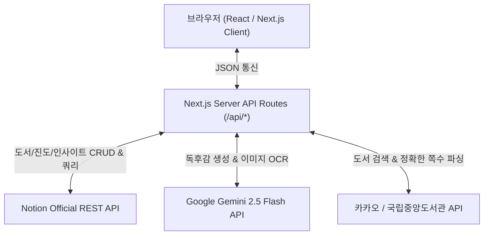

# 북튜닝 (Book Tuning) 아키텍처 명세서

## 1. 개요
기존 Google Apps Script(GAS) + Google Sheets 기반의 독서 기록 웹앱을 완전히 탈피하고, 노션 데이터베이스(Notion Database)를 Primary Database로 사용하는 Next.js 기반 풀스택 웹 애플리케이션입니다.

## 2. 노션 데이터베이스 스키마 명세 (100% 호환)

### (1) 사용자 DB (`NOTION_USER_DB_ID` - 신규)
| 프로퍼티명 | Notion 타입 | 설명 |
| :--- | :--- | :--- |
| `닉네임` | title | 사용자 닉네임 (활동명) |
| `PIN` | rich_text | 동명이인 방지 및 본인 인증용 4자리 핀번호 |
| `소개` | rich_text | 한 줄 소개 또는 프로필 문구 |
| `도서 목록` | relation | 도서 DB와의 양방향 관계 (해당 사용자가 등록한 책들) |
| `독서일지` | relation | 독서일지 DB와의 양방향 관계 |
| `문장수집` | relation | 문장수집 DB와의 양방향 관계 |
| 본문 블록 (Children) | Blocks | 사용자 개인 맞춤형 대시보드 (링크된 DB 뷰) |

### (2) 도서 DB (`NOTION_BOOK_DB_ID`)
| 프로퍼티명 | Notion 타입 | 설명 |
| :--- | :--- | :--- |
| `*책 제목` | title | 도서명 (필수) |
| `사용자` | relation | 사용자 DB Relation (신규 연결) |
| `저자` | rich_text | 저자명 |
| `출판사` | rich_text | 출판사명 |
| `*전체 페이지수` | number | 총 페이지 수 |
| `책소개` | rich_text | 도서 소개 내용 |
| `공감수` | number | 좋아요(공감) 수 |
| `공감한 사람` | rich_text | 공감 누른 사용자 닉네임 목록 (콤마 구분) |
| `체크박스` | checkbox | 완독 여부 플래그 |
| `기록자` | rich_text | 등록자 닉네임 (기존 텍스트 호환 유지) |
| `표지` | files (external) | 외부 표지 이미지 링크 |
| 본문 블록 (Children) | Blocks | `✨ Gemini AI 감상문`, `✍️ 나의 독서 감상문` |

### (3) 독서일지 / 진도 DB (`NOTION_LOG_DB_ID`)
| 프로퍼티명 | Notion 타입 | 설명 |
| :--- | :--- | :--- |
| `읽은 날짜` | title | 읽은 날짜 (YYYY-MM-DD) |
| `사용자` | relation | 사용자 DB Relation (신규 연결) |
| `관련 책` | relation | 도서 DB의 해당 도서 페이지 ID |
| `이번에 읽은 페이지(숫자)` | number | 당일 누적 읽은 페이지 |
| `독서 감상록` | rich_text | 진도 메모 및 간단 감상 |
| `기록자` | rich_text | 작성자 닉네임 (기존 호환 유지) |

### (4) 문장수집 / 인사이트 DB (`NOTION_INSIGHT_DB_ID`)
| 프로퍼티명 | Notion 타입 | 설명 |
| :--- | :--- | :--- |
| `내용` | title | 발췌한 핵심 문장 및 생각 |
| `사용자` | relation | 사용자 DB Relation (신규 연결) |
| `관련 책` | relation | 도서 DB의 해당 도서 페이지 ID |
| `페이지` | rich_text | 발췌 페이지 번호 |
| `읽은날짜` | date | 발췌한 일자 |
| `기록자` | rich_text | 작성자 닉네임 (기존 호환 유지) |
| 본문 블록 (Children) | Blocks | 촬영/첨부된 사진 이미지 블록 |

## 3. 시스템 데이터 흐름



## 4. 폴더 및 모듈 구조
```
├─ app/
│  ├─ api/
│  │  ├─ books/           # 도서 목록 조회(진도율 계산), 등록, 수정, 삭제
│  │  ├─ logs/            # 진도일지 등록, 수정, 삭제
│  │  ├─ insights/        # 문장수집 등록, 수정, 삭제, OCR
│  │  ├─ timeline/        # 도서별 전체 타임라인 및 본문 감상문 통합 조회
│  │  ├─ like/            # 공감 토글
│  │  ├─ my-report/       # 나의 감상문 노션 본문 블록 저장
│  │  ├─ search-books/    # 도서 검색 + 국립중앙도서관 쪽수 연동
│  │  └─ ai-report/       # Gemini 독후감 초안 생성 & 노션 첨부
│  ├─ globals.css         # 북튜닝 원본 감성 CSS 스타일
│  ├─ layout.tsx          # 메타데이터 및 폰트 래퍼
│  └─ page.tsx            # 메인 풀스택 SPA 화면 (모달, 탭, 갤러리)
├─ lib/
│  ├─ notion.ts           # Notion Client 초기화 및 DB ID 상수
│  └─ types.ts            # 공통 데이터 인터페이스
└─ docs/                  # 설계 및 작업 기록
```
